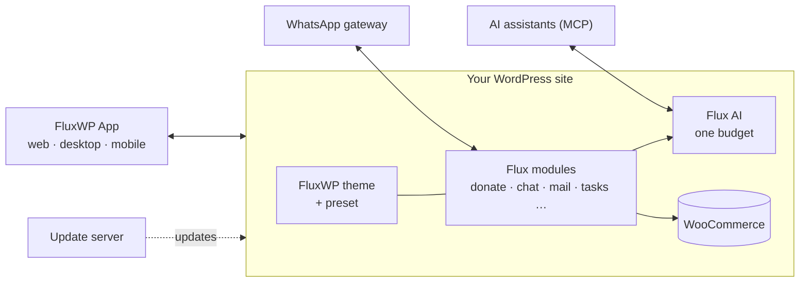

<picture>
  <source media="(prefers-color-scheme: dark)" srcset="https://raw.githubusercontent.com/FluxWP/.github/main/profile/assets/fluxwp-logo-dark.svg">
  
</picture>

### All-in-one WordPress (e-commerce) solutions

One site, one admin, one AI budget, one update server. 
Donations, online store, WhatsApp inbox, e-mail, AI, analytics and team tools that are built to work together.

---

## Why FluxWP?

Most WordPress sites grow into a patchwork: a donation plugin, a form plugin, an SMTP plugin, a chat widget and an analytics script, each with its own settings screen, its own upsell and its own idea of what the admin should look like.

FluxWP is built the other way round. Every package is a **Flux** module that snaps into the same foundation:

- 🧩 **Modules, not a patchwork.** An order or donation that comes in on WhatsApp is recorded, gets its certificate, sends its e-mail and shows up on the office TV, with no glue code.
- 🤖 **AI on one budget.** Keys, models and daily spending limits live in one place. Assistants like Claude work with your site through MCP.
- 📱 **One calm admin, also on a phone.** Same look in every package, a role-based menu, a mobile bottom bar and a command palette.
- 🔒 **Self-hosted, your data stays with you.** Cookie-free analytics, local backups, your own update server. Runs fine on shared hosting.
- 🌍 **Multilingual from day one.** Every package ships in English and Turkish; content goes multilingual with Flux Language.

## What you get

| | |
|---|---|
| 🛒 **Commerce & giving** | Flux Donation · Flux Forms · Flux Certificate · Flux QR Menu |
| 💬 **Communication** | Flux Call Center (WhatsApp inbox) · Flux Contact (e-mail, SMS) · Flux Social |
| 🤖 **AI & automation** | Flux AI · Flux SEO (MCP server) · Flux Studio · Flux Setup |
| 🧭 **Team & admin** | Flux Admin · Flux Roles · Flux Tasks · Flux App |
| 📈 **Growth** | Flux Site Analytics · Flux Language |
| 🛠️ **Operations** | Flux Updater · Flux Backup · Flux Performance |
| 📺 **Screens** | Flux TV Board · Flux TV Remote |
| 🎨 **Themes** | FluxWP (WooCommerce block theme) · Flux Menu Theme |

## Repositories

| Repository | What it is |
|---|---|
| [**FluxWP**](https://github.com/FluxWP/FluxWP) | The FluxWP Suite: the theme and all core Flux plugins in one monorepo, released package by package. |
| [**wp-extras**](https://github.com/FluxWP/wp-extras) | FluxWP Extras: presets that turn the theme into a ready site in one click, plus add-ons such as TV Board, TV Remote, Staff and Qurban. |
| [**updater**](https://github.com/FluxWP/updater) | FluxWP Updater server: delivers private themes and plugins to the normal WordPress updates screen. |
| [**whatsapp-api**](https://github.com/FluxWP/whatsapp-api) | A WhatsApp API gateway that connects your site's inbox and notifications to WhatsApp. |
| [**mobile**](https://github.com/FluxWP/mobile) | FluxWP App for iOS and Android: manage one or many WordPress sites from your phone. |

## How it fits together

## Get started

1. Install **Flux Updater** from the latest release and point it at your update server.
2. Pick the packages you need under **Dashboard › Updates** and click **Install**.
3. Apply a preset from **FluxWP Extras** to get a complete site in one click, or start from the plain FluxWP theme.

 

 
Built in the open, GPL-2.0-or-later, like WordPress itself.

